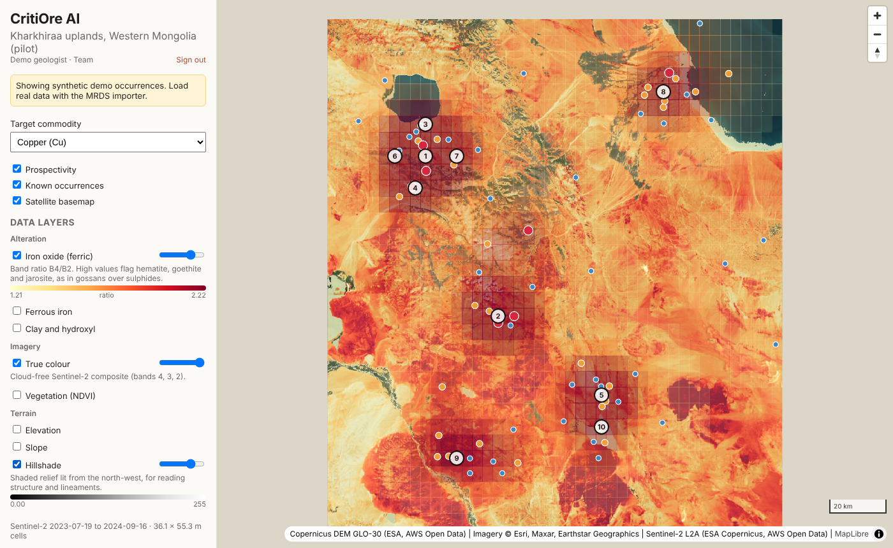

# CritiOre AI — MVP

GeoAI platform that ranks where to drill for critical minerals, starting with the
Kharkhiraa uplands pilot in Western Mongolia (Cu, Ni, Co). See the PRD for scope.

This is milestone 1 of the [MVP spec](https://claude.ai/code/artifact/24394e42-2f99-4d01-93e1-949f5aa98ac2):
real satellite and terrain layers for the pilot area, a signed-in web map, and
a **placeholder** prospectivity model that the real ML model will replace.



## What works today

- **Layer pipeline** (`backend/pipeline/`): pulls Copernicus DEM and a
  cloud-free Sentinel-2 L2A composite for the region straight from the public
  AWS Open Data buckets (no accounts), resamples everything onto one WGS84
  grid (0.0005°, about 36 × 55 m at the pilot), and writes Cloud-Optimized
  GeoTIFFs: elevation, slope, hillshade, true colour, NDVI, and three
  alteration ratios (ferric iron B4/B2, ferrous iron B12/B8 + B3/B4,
  clay/hydroxyl B11/B12, vegetation-masked).
- **Sign-in** with two roles: `team` sees every region; `client` is read-only
  and sees only the regions on their account.
- **Web map viewer** (React + MapLibre): satellite or street basemap, known
  occurrences coloured by type, a prospectivity heat grid, and the top 10
  ranked targets. Click anywhere to score that spot and see the evidence.
- **API** (FastAPI, Python): occurrences, regions, point scoring, a scored
  grid, and ranked targets. Interactive docs at http://localhost:8000/docs.
- **Placeholder model** (`backend/app/scoring.py`): scores a location by a
  Gaussian kernel over nearby known occurrences, weighted by site type
  (deposit > occurrence > showing) and commodity (an associated commodity
  counts half). It returns a 0–1 score, a confidence level, and the evidence
  behind it, which is the contract the trained model will keep.

> **The bundled occurrence data is synthetic.** `backend/data/occurrences.geojson`
> was generated by `scripts/generate_demo_data.py` so the app has something to
> show. Replace it with real data before drawing any conclusions.

## Run it

Requires Python 3.11+ and Node 20+.

```bash
# API
cd backend
python -m venv .venv && source .venv/bin/activate
pip install -r requirements-dev.txt
python -m scripts.add_user you@critiore.ai --name "You" --role team   # prompts for a password
python -m pipeline.run --region kharkhiraa   # builds data/layers/kharkhiraa (about 5 minutes, ~1 GB of range reads)
uvicorn app.main:app --reload            # http://localhost:8000/docs

# Web (second terminal)
cd frontend
npm install
npm run dev                              # http://localhost:5173
```

Or with Docker: `docker compose up`.

Tests: `cd backend && pytest`.

## API

Every route except health and login needs `Authorization: Bearer <token>`.

| Method | Path | What it does |
| --- | --- | --- |
| GET | `/api/health` | Status, model version, occurrence count |
| POST | `/api/auth/login` | `{email, password}` → `{token, user}` |
| GET | `/api/auth/me` | The signed-in user |
| GET | `/api/layers?region=kharkhiraa` | Built layers with legend colours, value ranges and sources |
| GET | `/api/layers/{region}/{layer}/tiles/{z}/{x}/{y}.png` | Map tiles for one layer |
| GET | `/api/layers/{region}/values?lat=&lon=` | Every layer's value at a point |
| GET | `/api/regions` | Pilot region(s) with bbox and commodities |
| GET | `/api/occurrences?commodity=Cu&bbox=s,w,n,e` | Occurrences as GeoJSON |
| GET | `/api/occurrences/{id}` | One occurrence |
| POST | `/api/prospectivity/score` | `{lat, lon, commodity}` → score, confidence, evidence |
| GET | `/api/prospectivity/grid?commodity=Cu&cell_deg=0.05` | Scored grid cells as GeoJSON polygons |
| GET | `/api/targets?commodity=Cu&limit=10` | Top targets, at least 10 km apart |

## Loading real data

USGS MRDS has global mineral occurrence records, including Mongolia:

1. Download MRDS as CSV from https://mrdata.usgs.gov/mrds/.
2. `cd backend && python -m scripts.import_mrds mrds.csv > data/occurrences.geojson`
   (keeps only sites inside the pilot bbox; `--all` keeps everything).
3. Restart the API, or point `CRITIORE_OCCURRENCES` at another GeoJSON file.

Digitised Soviet archive records should be written in the same GeoJSON shape
(`id`, `name`, `commodities`, `type`, `source`).

## Accounts

```bash
python -m scripts.add_user ana@critiore.ai --name "Ana" --role team
python -m scripts.add_user geo@client.mn --role client --regions kharkhiraa
python -m scripts.add_user geo@client.mn --remove
```

Accounts are stored with scrypt password hashes in `backend/data/users.json`
(override with `CRITIORE_USERS_FILE`). Set `CRITIORE_SECRET` to a long random
value in any shared deployment; without it, everyone is signed out when the API
restarts.

## Layer pipeline

```bash
python -m pipeline.run --region kharkhiraa                 # defaults: 0.0005° cells, Jul–Sep 2024 and 2023
python -m pipeline.run --region kharkhiraa --res 0.0003   # finer, slower
python -m pipeline.run --region kharkhiraa --skip-s2      # terrain only
```

Only the overview level that matches the grid is downloaded. Scenes are picked
per Sentinel-2 grid square by lowest cloud cover; clouds, shadow and snow are
masked with the scene classification band and gaps are filled from the next
clearest scene. Outputs go to `backend/data/layers/<region>/` with a
`layers.json` manifest listing the scenes used.

## Layout

```
backend/
  app/main.py        FastAPI routes
  app/scoring.py     placeholder prospectivity model (swap for ML)
  app/data.py        occurrence loader (swap for PostGIS)
  app/regions.py     pilot region definition
  app/auth.py        logins, roles, tokens
  app/layers.py      layer manifest, map tiles, point values
  pipeline/          builds raster layers (DEM, Sentinel-2, alteration indices)
  data/              occurrence GeoJSON
  scripts/           demo data generator, MRDS importer, add_user
  tests/
frontend/
  src/App.tsx        sidebar: commodity, layers, targets, clicked-point evidence
  src/MapView.tsx    MapLibre map and layers
```

## Next steps (from the PRD roadmap)

1. Load real occurrence data (MRDS, then digitised Soviet reports).
2. Move storage to PostGIS; add ASTER SWIR and EMIT mineral maps (need a NASA Earthdata login).
3. Replace the placeholder with a trained model and run the blind back-test
   (≥ 70% of known deposits in the top 10% of area).
4. Target report export (PDF + GIS files).
