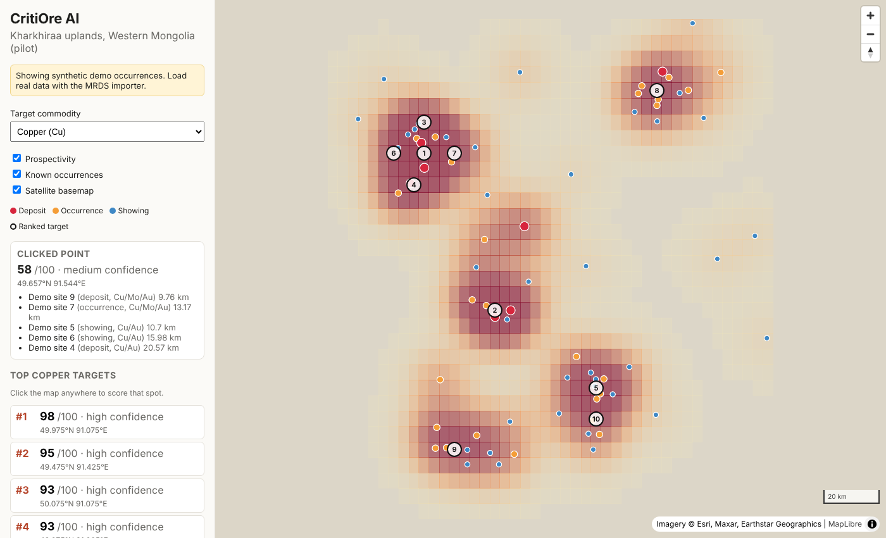

# CritiOre AI — MVP

GeoAI platform that ranks where to drill for critical minerals, starting with the
Kharkhiraa uplands pilot in Western Mongolia (Cu, Ni, Co). See the PRD for scope.

This is the first scaffold: a web map, a backend API, and a **placeholder**
prospectivity model that the real ML model will replace.



## What works today

- **Web map viewer** (React + MapLibre): satellite or street basemap, known
  occurrences coloured by type, a prospectivity heat grid, and the top 10
  ranked targets. Click anywhere to score that spot and see the evidence.
- **API** (FastAPI, Python): occurrences, regions, point scoring, a scored
  grid, and ranked targets. Interactive docs at http://localhost:8000/docs.
- **Placeholder model** (`backend/app/scoring.py`): scores a location by a
  Gaussian kernel over nearby known occurrences, weighted by site type
  (deposit > occurrence > showing) and commodity (an associated commodity
  counts half). It returns a 0–1 score, a confidence level, and the evidence
  behind it, which is the contract the trained model will keep.

> **The bundled occurrence data is synthetic.** `backend/data/occurrences.geojson`
> was generated by `scripts/generate_demo_data.py` so the app has something to
> show. Replace it with real data before drawing any conclusions.

## Run it

Requires Python 3.11+ and Node 20+.

```bash
# API
cd backend
python -m venv .venv && source .venv/bin/activate
pip install -r requirements-dev.txt
uvicorn app.main:app --reload            # http://localhost:8000/docs

# Web (second terminal)
cd frontend
npm install
npm run dev                              # http://localhost:5173
```

Or with Docker: `docker compose up`.

Tests: `cd backend && pytest`.

## API

| Method | Path | What it does |
| --- | --- | --- |
| GET | `/api/health` | Status, model version, occurrence count |
| GET | `/api/regions` | Pilot region(s) with bbox and commodities |
| GET | `/api/occurrences?commodity=Cu&bbox=s,w,n,e` | Occurrences as GeoJSON |
| GET | `/api/occurrences/{id}` | One occurrence |
| POST | `/api/prospectivity/score` | `{lat, lon, commodity}` → score, confidence, evidence |
| GET | `/api/prospectivity/grid?commodity=Cu&cell_deg=0.05` | Scored grid cells as GeoJSON polygons |
| GET | `/api/targets?commodity=Cu&limit=10` | Top targets, at least 10 km apart |

## Loading real data

USGS MRDS has global mineral occurrence records, including Mongolia:

1. Download MRDS as CSV from https://mrdata.usgs.gov/mrds/.
2. `cd backend && python -m scripts.import_mrds mrds.csv > data/occurrences.geojson`
   (keeps only sites inside the pilot bbox; `--all` keeps everything).
3. Restart the API, or point `CRITIORE_OCCURRENCES` at another GeoJSON file.

Digitised Soviet archive records should be written in the same GeoJSON shape
(`id`, `name`, `commodities`, `type`, `source`).

## Layout

```
backend/
  app/main.py        FastAPI routes
  app/scoring.py     placeholder prospectivity model (swap for ML)
  app/data.py        occurrence loader (swap for PostGIS)
  app/regions.py     pilot region definition
  data/              occurrence GeoJSON
  scripts/           demo data generator, MRDS importer
  tests/
frontend/
  src/App.tsx        sidebar: commodity, layers, targets, clicked-point evidence
  src/MapView.tsx    MapLibre map and layers
```

## Next steps (from the PRD roadmap)

1. Load real occurrence data (MRDS, then digitised Soviet reports).
2. Move storage to PostGIS and add raster layers (Sentinel-2 / ASTER alteration).
3. Replace the placeholder with a trained model and run the blind back-test
   (≥ 70% of known deposits in the top 10% of area).
4. Target report export (PDF + GIS files).
