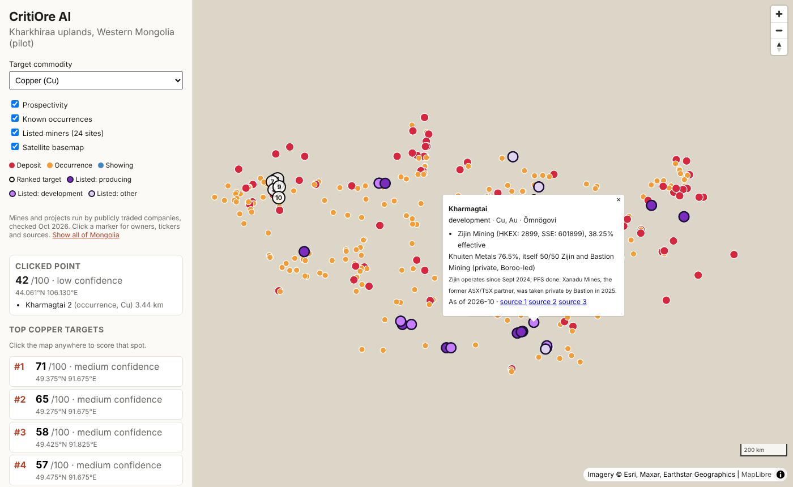

# Listed miners in Mongolia

Mines and projects in Mongolia run by publicly traded companies, shown on the map as the
**Listed miners** layer and served at `GET /api/listed-miners?status=producing`.

The list was checked in October 2026 against company releases, exchange filings and the
Global Energy Monitor coal tracker. It lives in `backend/scripts/build_listed_miners.py`; edit
the `SITES` list there and run `python -m scripts.build_listed_miners` to rebuild
`backend/data/listed_miners_mongolia.geojson`. A `~` after the coordinates means the point was
placed from a licence centre or a stated distance and bearing, so it is good to about 10 km.

**24 sites, 17 listed companies.**

| Site | Listed company (tickers) and stake | Commodities | Status | Province | Lat, lon | Sources |
| --- | --- | --- | --- | --- | --- | --- |
| Oyu Tolgoi | Rio Tinto (LSE: RIO, ASX: RIO, NYSE: RIO) 66% | Cu, Au, Ag | producing | Ömnögovi | 43.003, 106.858 | [1](https://www.sec.gov/Archives/edgar/data/0000863064/000086306426000041/ex1prodresults.htm) [2](https://pubs.usgs.gov/of/2003/of03-220/) |
| Hugo North Extension (Shivee Tolgoi licence) | Entrée Resources (TSX: ETG, OTCQB: ERLFF) 20% | Cu, Au | development | Ömnögovi | 43.080, 106.870 ~ | [1](https://pipelineroad.com/news/20260409-entr-e-resources-updates-on-joint-venture-licenses-and-explo) |
| Heruga (Javhlant licence) | Entrée Resources (TSX: ETG, OTCQB: ERLFF) 30% | Cu, Au, Mo | exploration | Ömnögovi | 42.950, 106.800 ~ | [1](https://pipelineroad.com/news/20260409-entr-e-resources-updates-on-joint-venture-licenses-and-explo) |
| Ukhaa Khudag | Mongolian Mining Corporation (HKEX: 975) 100% | coking coal | producing | Ömnögovi | 43.667, 105.518 | [1](https://www.mmc.mn/storage/announcements/July2026/eYBYJpa6W6Dgn3MC7Ucq.pdf) [2](https://www.gem.wiki/Ukhaa_Khudag_Coal_Mine) |
| Baruun Naran | Mongolian Mining Corporation (HKEX: 975) controlled | coking coal | producing | Ömnögovi | 43.598, 105.223 | [1](https://www.mmc.mn/storage/announcements/July2026/eYBYJpa6W6Dgn3MC7Ucq.pdf) [2](https://www.gem.wiki/Baruun_Naran_Coal_Mine) |
| Bayan Khundii | Erdene Resource Development (TSX: ERD, MSE: ERDN, OTCQX: ERDCF) 50%; Mongolian Mining Corporation (HKEX: 975) 50% | Au, Ag | producing | Bayankhongor | 43.949, 98.800 ~ | [1](https://www.cruxinvestor.com/posts/erdene-resource-development-reports-q2-2026-gold-production-and-advances-khundii-district-projects) [2](https://www.mmc.mn/storage/announcements/July2026/eYBYJpa6W6Dgn3MC7Ucq.pdf) [3](https://erdene.com/site/assets/files/3974/bayan_khundii_march_2017_technical_report.pdf) |
| Altan Nar | Erdene Resource Development (TSX: ERD, MSE: ERDN, OTCQX: ERDCF) 100% | Au, Ag, Pb, Zn | development | Bayankhongor | 44.080, 98.700 ~ | [1](https://www.cruxinvestor.com/posts/erdene-resource-development-reports-q2-2026-gold-production-and-advances-khundii-district-projects) [2](https://erdene.com/site/assets/files/3974/bayan_khundii_march_2017_technical_report.pdf) |
| Zuun Mod | Erdene Resource Development (TSX: ERD, MSE: ERDN, OTCQX: ERDCF) 100% | Mo, Cu | development | Bayankhongor | 43.950, 99.300 ~ | [1](https://www.cruxinvestor.com/posts/erdene-resource-development-reports-q2-2026-gold-production-and-advances-khundii-district-projects) [2](https://erdene.com/site/assets/files/3974/bayan_khundii_march_2017_technical_report.pdf) |
| ATO (Altan Tsagaan Ovoo) | Steppe Gold (TSX: STGO, OTCQX: STPGF) 100% | Au, Ag, Pb, Zn | producing | Dornod | 48.550, 112.720 ~ | [1](https://www.newsfilecorp.com/release/218595) [2](https://www.mining-technology.com/projects/altan-tsagaan-ovoo-ato-gold-and-silver-project-dornod-mongolia/) |
| Boroo | Steppe Gold (TSX: STGO, OTCQX: STPGF) 100% | Au | producing | Selenge | 48.750, 106.150 | [1](https://www.newsfilecorp.com/release/218595) [2](https://miningdataonline.com/property/1030/Boroo-Mine.aspx) [3](https://pubs.usgs.gov/of/2003/of03-220/) |
| Ulaanbulag | Steppe Gold (TSX: STGO, OTCQX: STPGF) 100% | Au | producing | Selenge | 48.620, 106.350 ~ | [1](https://www.newsfilecorp.com/release/218595) [2](https://miningdataonline.com/property/1030/Boroo-Mine.aspx) |
| Ovoot Tolgoi | SouthGobi Resources (HKEX: 1878, TSXV: SGQ) 100% | coking coal, thermal coal | producing | Ömnögovi | 43.002, 101.261 | [1](https://www.newswire.com/news/southgobi-announces-second-quarter-2026-unaudited-financial-and-operating) [2](https://www.gem.wiki/Ovoot_Tolgoi_Coal_Mine) |
| Soumber | SouthGobi Resources (HKEX: 1878, TSXV: SGQ) 100% | coking coal | development | Ömnögovi | 43.000, 101.510 ~ | [1](https://www.newswire.com/news/southgobi-announces-second-quarter-2026-unaudited-financial-and-operating) |
| Khushuut | Mongolia Energy Corporation (HKEX: 276) 100% | coking coal | producing | Khovd | 46.807, 93.310 | [1](https://www.webull.com.au/news-detail/15439987216917504) [2](https://www.gem.wiki/Khushuut_Coal_Mine) |
| Kharmagtai | Zijin Mining (HKEX: 2899, SSE: 601899) 38.25% effective | Cu, Au | development | Ömnögovi | 44.032, 106.144 | [1](https://www.businessnews.com.au/article/Xanadu-hands-ball-to-Zijin-for-Mongolian-copper-gold-goal) [2](https://www.tipranks.com/news/company-announcements/xanadu-mines-ltd-to-be-delisted-following-acquisition) [3](https://pubs.usgs.gov/of/2003/of03-220/) |
| Ovoot coking coal project | Aspire Mining (ASX: AKM) 100% | coking coal | development | Khövsgöl | 49.364, 97.496 ~ | [1](https://www.gem.wiki/Ovoot_Coking_Project) |
| Ulaan Ovoo | Silver Elephant Mining (TSX: ELEF, OTCQB: SILEF) 100% | thermal coal | standby | Selenge | 50.318, 104.974 | [1](https://www.newsfilecorp.com/release/304044) [2](https://www.gem.wiki/Ulaan_Ovoo_Coal_Mine) |
| Baganuur | Baganuur JSC (MSE: BAN) 100% | thermal coal | producing | Ulaanbaatar (Baganuur) | 47.751, 108.325 | [1](https://www.gem.wiki/Baganuur_Coal_Mine) [2](https://en.wikipedia.org/wiki/List_of_companies_listed_on_the_Mongolian_Stock_Exchange) |
| Shivee Ovoo | Shivee Ovoo JSC (MSE: SHV) 100% | thermal coal | producing | Govisümber | 46.224, 108.531 ~ | [1](https://www.gem.wiki/Shivee-Ovoo_mine) [2](https://en.wikipedia.org/wiki/List_of_companies_listed_on_the_Mongolian_Stock_Exchange) |
| Tavan Tolgoi (provincial licence) | Tavan Tolgoi JSC (MSE: TTL) 100% | coking coal | producing | Ömnögovi | 43.652, 105.442 ~ | [1](https://www.gem.wiki/Tavan_Tolgoi_(Small)_Coal_Mine) [2](https://en.wikipedia.org/wiki/List_of_companies_listed_on_the_Mongolian_Stock_Exchange) |
| Sharyn Gol | Sharyn Gol JSC (MSE: SHG) 100% | thermal coal | unverified | Darkhan-Uul | 49.228, 106.422 | [1](https://en.wikipedia.org/wiki/Sharyn_Gol_Coal_Mine) [2](https://en.wikipedia.org/wiki/List_of_companies_listed_on_the_Mongolian_Stock_Exchange) |
| Aduunchuluun | Aduunchuluun JSC (MSE: ADL) 100% | thermal coal | producing | Dornod | 48.127, 114.538 | [1](https://www.gem.wiki/Aduunchuluun_Coal_Mine) [2](https://en.wikipedia.org/wiki/List_of_companies_listed_on_the_Mongolian_Stock_Exchange) |
| Mogoin Gol | Mogoin Gol JSC (MSE: BDL) 100% | thermal coal | producing | Khövsgöl | 49.358, 97.830 | [1](https://www.gem.wiki/Mogoin_Gol_Coal_Mine) [2](https://en.wikipedia.org/wiki/List_of_companies_listed_on_the_Mongolian_Stock_Exchange) |
| Bayanteeg | Bayanteeg JSC (MSE: BTG) 100% | thermal coal | unverified | Övörkhangai | 45.697, 101.560 | [1](https://en.wikipedia.org/wiki/Bayanteeg_Coal_Mine) [2](https://en.wikipedia.org/wiki/List_of_companies_listed_on_the_Mongolian_Stock_Exchange) |

## Left out, and why

- **Erdenes Tavan Tolgoi** (the main Tavan Tolgoi field), **Erdenet** and other state miners:
  not listed. ETT signed an MOU with the Mongolian Stock Exchange in 2026 to prepare a listing,
  so it should be added when it trades.
- **Xanadu Mines**: taken private by Bastion Mining in 2025 and delisted from the ASX. Its
  Kharmagtai project is shown under its listed partner, Zijin.
- **Kincora Copper**: sold its Mongolian assets in 2026.
- **Banpu (Hunnu Coal)**: no current activity found in Mongolia.
- **Smaller Mongolian Stock Exchange miners** that could not be placed on the map yet:
  Khotgor (NHT), Tevshiin Gobi (TVG), Khar Tarvagatai (TVT), Taliin Gal (TAL) for coal;
  Khailaast (HST), Boroogiin Yildver (BRO), Shoroon Ord for gold; Bayanmod Uul (BNM) for tin;
  Berkh Uul (BEU) for fluorspar. Most are small or dormant.
- **Royalty holders** (e.g. on Oyu Tolgoi or Bayan Khundii) and oil and gas companies are out of scope.
- MMC's White Hill copper and Urkhut silver projects (via Universal Copper LLC, 50.5%) are not
  mapped yet because their locations are not published.
