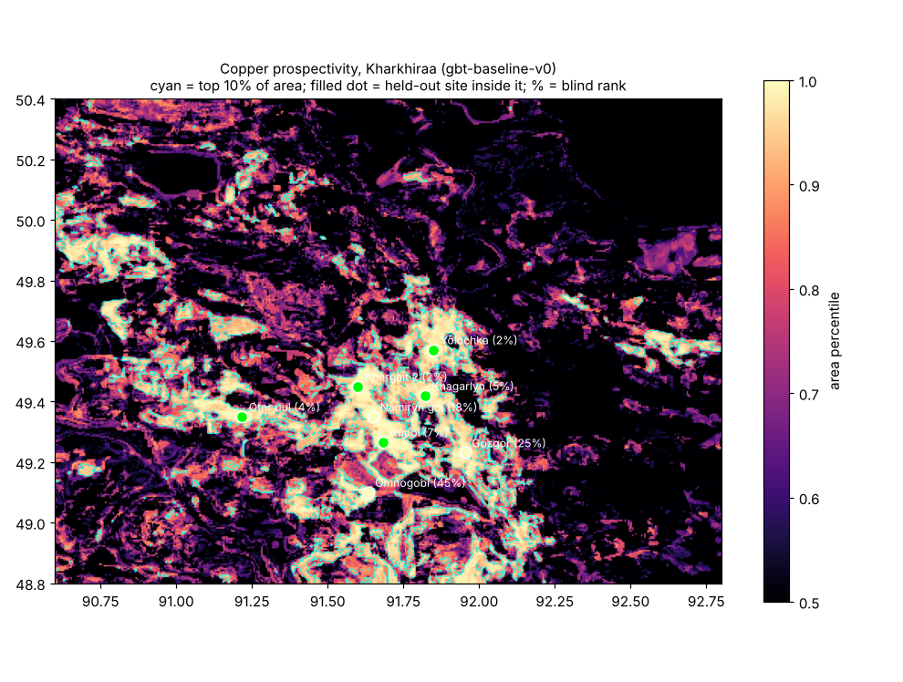

# Prospectivity baseline (gbt-baseline-v0)

First data-driven model for the Kharkhiraa pilot, and the blind back-test that the
PRD gate is measured with: **at least 70% of known deposits inside the top 10% of
the area**. Code: `backend/ml/`. Run on 16 Oct 2026.



## Result

Share of held-out sites that land inside the top 10% of the area:

| Group | Sites | Model | Proximity placeholder | Random |
| --- | --- | --- | --- | --- |
| Cu | 8 | **62%** (5 of 8) | 50% | 10% |
| Cu-Mo-Au-W | 10 | **60%** (mean of 50%, 70%, 60% over 3 background samples) | 30% | 10% |

Median blind rank: Cu top 6% (proximity top 11%), Cu-Mo-Au-W top 7% (proximity top 19%).

Per Cu site (blind rank = share of area scoring higher): Yolochka 2%, Khargait 2 2%,
Otor uul 4%, Khagarlyn 5%, Kupol 7%, Namiryn gol 18%, Gozgor 25%, Omnogobi 45%.

**Below the 70% gate, but well above chance, and better than the placeholder.** The
model also finds Otor uul, Achit nuur (W) and Umnu Khutel (W-Mo), which sit away
from the main cluster and which the proximity placeholder misses.

## How it works

- **Evidence stack** (`ml/features.py`): elevation, slope, NDVI, ferric iron, ferrous
  iron, clay/hydroxyl and six Sentinel-2 bands, averaged onto a 0.005 deg grid
  (~360 x 555 m, 320 x 440 cells). Each layer also gets its local mean, spread and
  anomaly over ~1.5 km and ~5 km windows: 84 features in all.
- **Model** (`ml/backtest.py`): gradient-boosted trees. Cells within 1.5 km of a known
  site are positives (USGS coordinates are only good to a few km); 20,000 random
  cells elsewhere are unlabelled background, not "barren".
- **Back-test**: leave one site out. Its cells and everything within 5 km are dropped
  from training, the model scores the whole area, and the site's rank is taken from
  the mean score within 1.5 km of it. Repeated over 3 background samples.

## What the model leans on

Clay/hydroxyl spread over ~5 km, slope spread over ~5 km, and ~5 km mean elevation
come first, then SWIR (B11) spread and iron-oxide texture. That fits porphyry-style
alteration in rugged ground, with one caution: mean elevation partly works as a
"where the known cluster is" signal rather than geology.

## Caveats

- 8 Cu sites is a small sample: each one moves the hit rate by 12.5 points.
- Five of the Cu sites sit within ~25 km of each other, so a held-out site still has
  neighbours in training on similar terrain. The 5 km exclusion only partly controls
  this; the real gate test should hold out whole blocks once there are more sites.
- The published map is trained on all sites, so it ranks the known sites near the top
  by construction. Only the back-test numbers above are blind.

## Next steps that should move the number

1. **More sites**: occurrences from the Soviet archive (LLM extraction), and training
   across the wider Altai belt, which needs the layers built there too.
2. **Geology evidence**: distance to granitoid intrusions, fault density and rock type
   from the Soviet 1:200k maps; open magnetics (EMAG2) and gravity.
3. Then switch the back-test to spatial blocks and wire the model into
   `/api/prospectivity` behind the same score, confidence and evidence contract.

## Reproduce

```bash
cd backend
pip install -r requirements-ml.txt
python -m ml.run_baseline --layers /path/to/layers/kharkhiraa --out out/kharkhiraa
```

It writes `prospectivity_<group>.tif` and `report.json`, and takes about 30 minutes on
4 cores (54 model fits). Outputs from this run are in the project folder at
`critiore-mvp/models/kharkhiraa/`.
